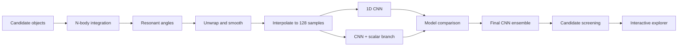
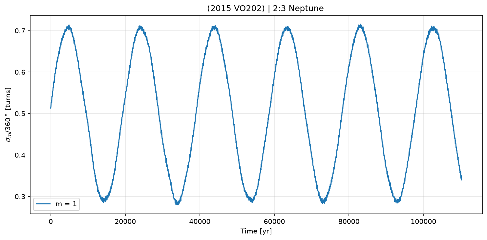
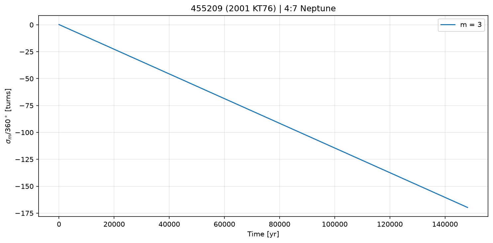
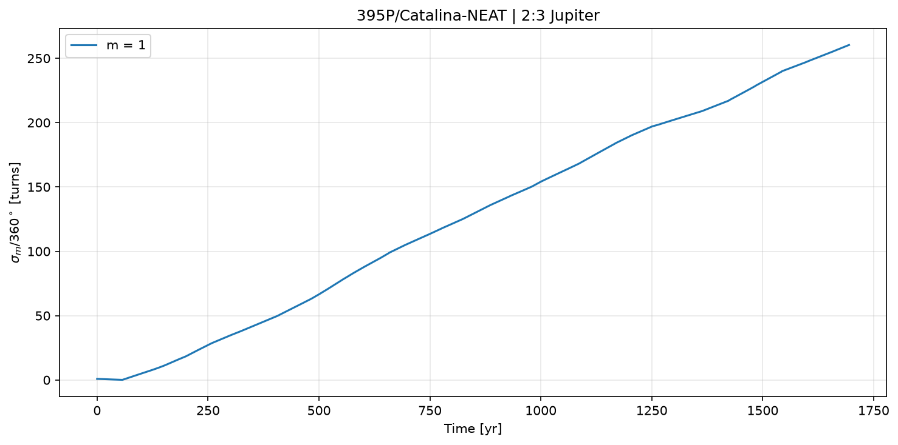
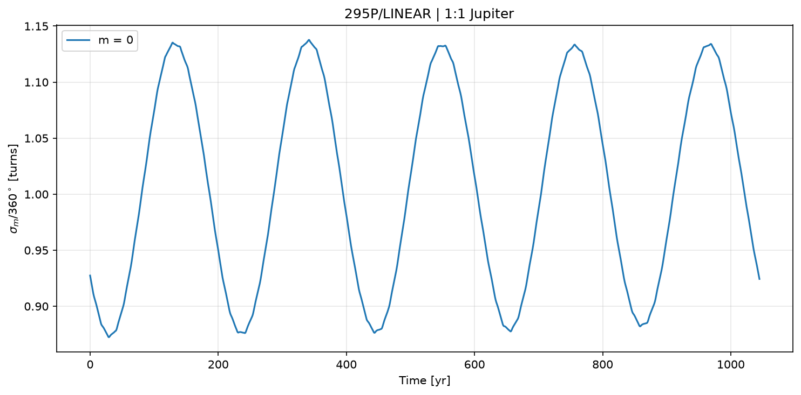
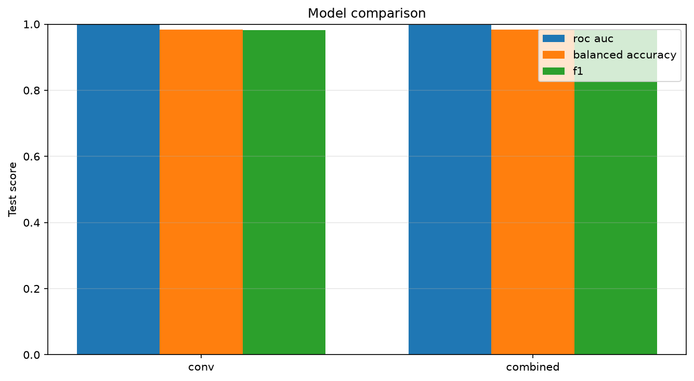
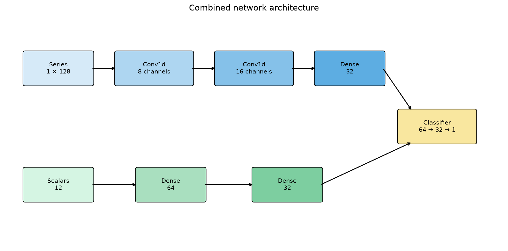
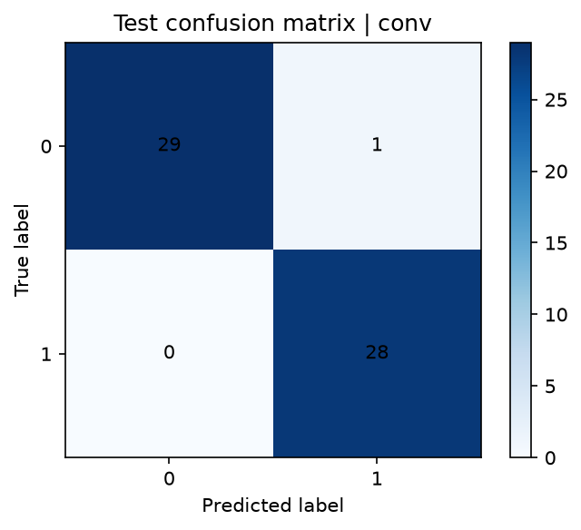
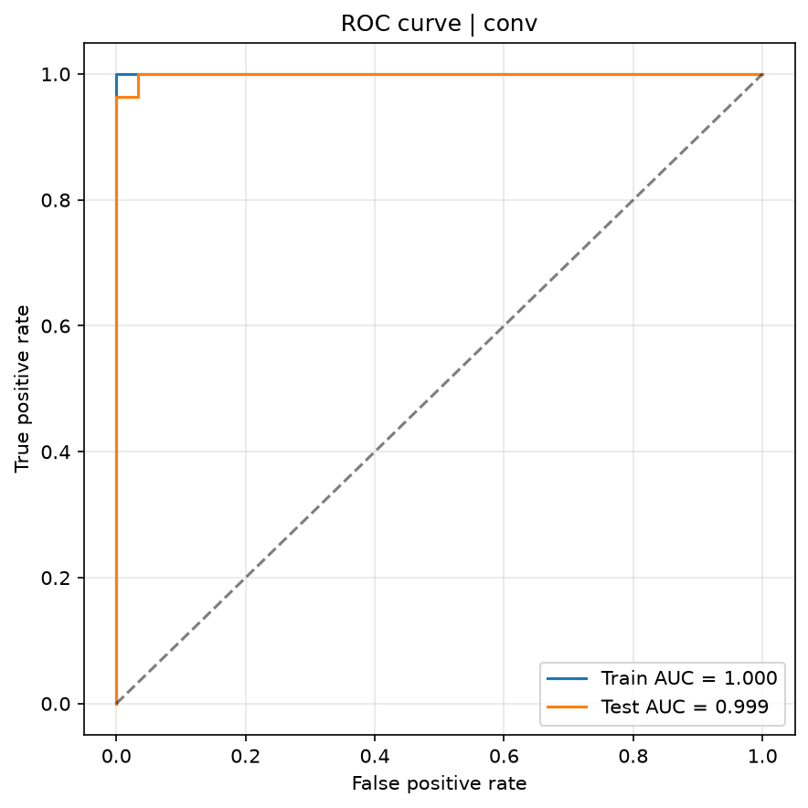
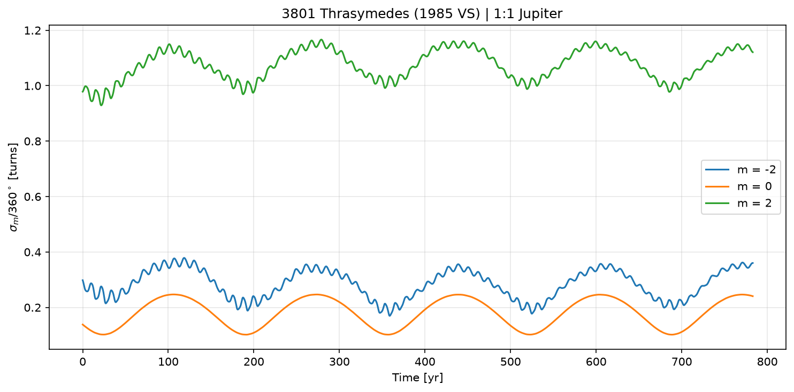

# Orbital Resonance ML

**A physics-informed 1D convolutional neural network for classifying orbital-resonance time series in minor Solar System bodies.**


[Explore the predictions](https://santiagogr11.github.io/orbital-resonance-ml/) · [View the evaluation outputs](outputs/ml/evaluation/metrics/) · [See the wider TFG project](https://github.com/SantiagoGR11/centaur-jwst)

## Why this project exists

Mean-motion resonances are identified through the evolution of a resonant angle. A resonant angle that remains bounded **librates**; one that repeatedly traverses the full angular domain **circulates**. The distinction is easy for clean signals but becomes less obvious for perturbed objects, particularly Jupiter-family comets and temporarily resonant Centaurs.

This repository turns that physical diagnosis into a supervised time-series classification problem. It was developed within my Physics undergraduate thesis at the **University of Oviedo**, as part of a pipeline for selecting Centaurs before a subsequent JWST/MIRI observability study.

The project is deliberately small and interpretable: it tests whether a compact 1D CNN can learn the relevant morphology directly from the angular series, and whether adding hand-engineered physical descriptors provides a measurable advantage.

## At a glance

| Item | Result |
|---|---:|
| Labeled objects used for ML | **289** |
| Saved development split | **231 / 58 objects** |
| Selected CNN parameters | **945** |
| CNN accuracy on the saved split | **98.28%** |
| CNN ROC AUC | **0.9988** |
| Candidate object-resonance pairs screened | **286** |
| Pairs flagged as potentially librating | **218** |

The split is performed by physical object, so different representations of the same body cannot leak between subsets.

## Scientific and ML workflow



For a resonance described by integer coefficients $k$ and $k_p$, the integrated angular arguments follow the convention

$$
\sigma_m = k\lambda - k_p\lambda_p - (k-k_p)\Omega - m\omega.
$$

Each object-planet-resonance association can have several admissible values of $m$. During application, the modes are inspected in a physically motivated order: prograde, retrograde, zero when admissible, and then the remaining modes. The search stops at the first positive classification.

## Building a useful training set

Random minor bodies would mostly produce uninformative circulation examples. The sample was therefore constructed around physically relevant populations:

| Sampling group | Objects | Circulation | Libration |
|---|---:|---:|---:|
| Jupiter-family comets | 89 | 48 | 41 |
| Volk-Malhotra resonant TNOs | 100 | 0 | 100 |
| Volk-Malhotra non-resonant TNOs | 100 | 100 | 0 |
| **Total** | **289** | **148** | **141** |

The TNO identities and dynamical labels come from the dataset associated with Volk and Malhotra (2024). Their orbital elements are not reused: the objects are matched to **JPL SBDB**, integrated again with this project's pipeline, and converted into new resonant-angle series. Jupiter-family comets are included because their strongly perturbed trajectories provide harder examples than the clean TNO populations.

The original candidate catalog is excluded from the training sample by SPK ID. Clones are not treated as independent objects.

### Representative inputs

| Resonant TNO: 2015 VO202 | Non-resonant TNO: 455209 (2001 KT76) |
|---|---|
|  |  |
| Neptune 2:3, label **1** | Neptune 4:7 candidate, label **0** |

| JFC circulation: 395P/Catalina-NEAT | JFC libration: 295P/LINEAR |
|---|---|
|  |  |
| Jupiter 2:3, label **0** | Jupiter 1:1, label **1** |

`JFc` is a population label, not a resonance label: the group intentionally contains both classes.

## Preprocessing the time series

The network receives the evolution of the resonant angle rather than an image of its plot. For every training object:

1. The complete integrated angle is unwrapped and expressed relative to its initial value.
2. A light Savitzky-Golay filter removes numerical-scale fluctuations without reducing the number of samples.
3. Time is normalized to $[0,1]$.
4. Angular displacement is expressed in turns, $\Delta\sigma/(2\pi)$; its physical amplitude is not normalized away.
5. The signal is interpolated to **128 samples**.

The scalar branch of the comparison model additionally receives resonance scales, physical duration, final displacement, slope and integrated-deviation descriptors. These quantities are standardized from the training subset only.

## Models and experimental decision

Two architectures were evaluated under the same object-level split:

| | 1D CNN | CNN + scalar branch |
|---|---:|---:|
| Input | 128-point angle series | Series + 12 scalar descriptors |
| Convolutional channels | 8 → 16 | 8 → 16 |
| Trainable parameters | **945** | **21,873** |
| Accuracy | **98.28%** | **98.28%** |
| ROC AUC | **0.9988** | **0.9976** |
| Brier score | 0.0175 | **0.0134** |

Both models use binary cross-entropy with logits, Adam, a learning rate of `1e-3`, weight decay of `1e-4`, batch size `32` and dropout `0.2`.



The combined model is useful as an ablation experiment: it tests whether explicit physical descriptors add information beyond the signal itself. It reaches the same classification accuracy but requires roughly **23 times more parameters**. The compact CNN was therefore selected for final application.

<p align="center">
  
</p>

## Evaluation results

The selected CNN correctly classifies **57 of 58 objects** in the saved 80/20 split. The only error belongs to the JFC subset; both Volk-Malhotra groups are classified correctly.

| Metric | 1D CNN |
|---|---:|
| Accuracy | 0.9828 |
| Balanced accuracy | 0.9833 |
| Precision | 0.9655 |
| Recall | **1.0000** |
| F1 | 0.9825 |
| ROC AUC | 0.9988 |

| Confusion matrix | ROC curve |
|---|---|
|  |  |

These numbers describe the recorded exploratory split. The subset named `test` in the original code is also used to select the minimum-loss epoch, so it acts as a **development/validation set**, not as a fully independent final test set. The repository keeps that distinction explicit rather than reporting the score as an unbiased estimate of deployment performance.

## Final model and conservative candidate screening

The final CNN is trained on all 289 labeled objects. Predictions are averaged across checkpoints from epochs **80, 85, 90, 95 and 100**, which reduces dependence on a single stochastic training state.

For the application catalog, only the first **two estimated libration periods** are presented to the ensemble. This emphasizes possible initial or temporary libration: the downstream scientific objective is conservative filtering, where overlooking a potentially resonant object is more costly than retaining a false positive.

| Application snapshot | Count |
|---|---:|
| Distinct physical objects | **251** |
| Object-planet-resonance pairs | **286** |
| Flagged as librating | **218** |
| Classified as circulating | **68** |

For example, the model identifies the bounded 1:1 resonant angle of Jupiter Trojan **3801 Thrasymedes** with a score of 0.9986:



Application scores are screening outputs, not an additional accuracy measurement.

## Interactive results explorer

The static interface in [`docs/`](docs/) exposes the application results without a backend. It supports:

- search by object name, SPK ID or case identifier;
- filters by dynamical class, planet, resonance and predicted result;
- inspection of the original integrated resonant-angle plots.

**[Open the live explorer](https://santiagogr11.github.io/orbital-resonance-ml/)**

`scripts/07_build_results_site.py` converts the result table to JSON and refreshes the plots used by the site. GitHub Pages serves the same `docs/` directory.

## Reproducing the experiment

### Installation

```bash
git clone https://github.com/SantiagoGR11/orbital-resonance-ml.git
cd orbital-resonance-ml
python -m venv .venv
```

Activate the environment and install the project:

```bash
# Linux / macOS
source .venv/bin/activate

# Windows PowerShell
.venv\Scripts\Activate.ps1

python -m pip install -r requirements.txt
python -m pip install --no-deps -e .
```

Python 3.11 or newer is required. Training automatically uses CUDA when it is available and otherwise falls back to CPU.

### Re-run the saved ML experiment

The prepared 128-point series are included, so model evaluation and final training can be repeated directly:

```bash
python scripts/04_train_ml_models.py
python scripts/05_train_final_ml_model.py
```

### Rebuild from orbital integrations

```bash
python scripts/01_build_ml_sample.py
python scripts/02_integrate_ml_sample.py
python scripts/03_prepare_ml_dataset.py
python scripts/04_train_ml_models.py
python scripts/05_train_final_ml_model.py
```

The integration HDF5 files are kept out of Git because they exceed GitHub's per-file limit:

- `data/ml/integrations/training_timeseries.h5` (~621 MiB)
- `data/resonance_results/timeseries.h5` (~153 MiB)

The training HDF5 can be regenerated with script 02. Re-running candidate classification with script 06 additionally requires the candidate integration file produced by the upstream `centaur-jwst` dynamics pipeline.

Once predictions are available, rebuild the web assets with:

```bash
python scripts/06_classify_resonance_candidates.py
python scripts/07_build_results_site.py
python -m http.server 8000 --directory docs
```

Then open `http://localhost:8000`.

## Repository layout

```text
orbital-resonance-ml/
├── data/
│   ├── ml/                    # sample, prepared inputs and integration summaries
│   ├── processed/             # resonance strengths and application candidates
│   └── resonance_results/     # pair- and mode-level predictions
├── docs/                      # static results explorer for GitHub Pages
├── outputs/
│   ├── ml/                    # metrics, checkpoints and training plots
│   └── resonance_plots/       # application plots
├── scripts/                   # seven executable pipeline stages
└── src/resonances/
    ├── ml/                    # datasets, preprocessing, models, training, evaluation
    └── ...                    # supporting resonance and integration code
```

## Design choices demonstrated here

- **Group-aware splitting:** separation by physical object prevents leakage.
- **Physics-informed sampling:** difficult populations are included deliberately instead of relying on random catalog sampling.
- **Ablation through model comparison:** the scalar branch is retained as an experiment even though the simpler CNN is selected.
- **Reproducible artifacts:** split identities, metrics, probabilities, checkpoints and preprocessing metadata are saved.
- **Traceable inference:** every tested resonant mode has its own probability and ensemble dispersion.
- **Deployment-oriented output:** predictions are exported to a lightweight, searchable static application.

## Limitations and next steps

- The 58-object development subset is small and is used for checkpoint selection; repeated group-aware cross-validation would give a stronger uncertainty estimate.
- The training set mixes labeled TNOs with curated JFCs, while the application population is dominated by Centaurs. This population shift should be quantified explicitly.
- Training uses the complete five-period integrations, whereas application uses an initial two-period window as a high-recall screening policy. A dedicated two-period training experiment would separate the effect of that policy from distribution shift.
- The current output is binary. A future formulation could distinguish sustained libration, temporary libration, circulation and indeterminate cases.
- Ensemble dispersion measures disagreement between checkpoints, not full epistemic or physical uncertainty.

## References

- **Volk, K. & Malhotra, R. (2024).** *Machine Learning Assisted Dynamical Classification of Trans-Neptunian Objects.* [arXiv:2405.05185](https://arxiv.org/abs/2405.05185)
- **Gallardo, T. (2007).** *Evaluating the Signatures of the Mean Motion Resonances in the Solar System.* [arXiv:0708.2080](https://arxiv.org/abs/0708.2080)
- **Gallardo, T. (2018).** *Strength, stability and three dimensional structure of mean motion resonances in the Solar System.* [arXiv:1807.07956](https://arxiv.org/abs/1807.07956)
- [SBDynT](https://github.com/small-body-dynamics/SBDynT) — source of the Volk-Malhotra classification table.
- [JPL Small-Body Database](https://ssd.jpl.nasa.gov/tools/sbdb_query.html) and [Horizons](https://ssd.jpl.nasa.gov/horizons/) — orbital data and planetary initial conditions.
- [REBOUND](https://rebound.readthedocs.io/) — N-body integration.

## Author

**Santiago García Rodríguez** — BSc Physics, University of Oviedo
[GitHub](https://github.com/SantiagoGR11) · [LinkedIn](https://www.linkedin.com/in/santiagogarciarod/)

Developed as part of the `centaur-jwst` undergraduate thesis project under the supervision of **Noemí Pinilla-Alonso (ICTEA)**.
